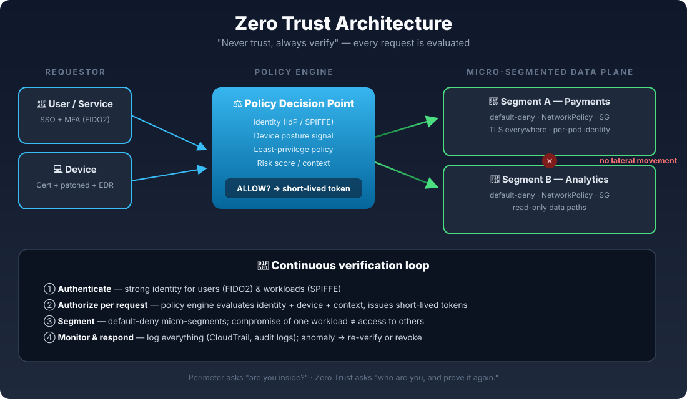

# Zero Trust Security Guide

[](.)
[](.)
[](.)
[](.)

**"Never trust, always verify."** — The old castle-and-moat model is dead. Zero Trust assumes the network is already compromised and verifies every request, every time, based on identity, device posture, and context.

> 🏰 **TL;DR:** Perimeter security asks *"are you inside the network?"* Zero Trust asks *"who are you, what device is this, what are you allowed to do — and can you prove it again in the next request?"* This guide breaks the model into 5 implementable pillars with Terraform and Kubernetes examples.

---

## Why Perimeter Security Failed

For decades, security looked like a castle: thick firewall walls, soft on the inside. Once an attacker got past the VPN or the firewall, they could move freely. Modern reality kills that model:

- Workforces are remote — there is no "inside" anymore
- Workloads are ephemeral — pods spin up and down in seconds
- Attackers live off the land — stolen credentials, not exploits

The average data breach costs **USD 4.4 million** (IBM, 2025). Zero Trust shrinks that blast radius by making every single access decision explicit.

---

## The 5 Pillars of Zero Trust



| Pillar | What it means | AWS implementation | Kubernetes implementation |
|---|---|---|---|
| **1. Identity** | Users AND workloads get strong, verifiable identities | IAM Identity Center + short-lived STS tokens | SPIFFE/SPIRE workload identity, service accounts |
| **2. Device posture** | Access depends on device health, not just credentials | AWS Verified Access device certificates | Node/image attestation, signed images (cosign) |
| **3. Least privilege** | Default-deny; grant the minimum needed | SCPs + permission boundaries + Access Analyzer | RBAC + NetworkPolicy default-deny |
| **4. Micro-segmentation** | Break the network into tiny isolated zones | Security Groups + VPC endpoints, no 0.0.0.0/0 | NetworkPolicies per namespace/pod |
| **5. Continuous verification** | Re-check on every request, log everything | CloudTrail + GuardDuty + Verified Access logs | Audit logs + Falco runtime detection |

## Zero Trust vs Perimeter Model

| | Perimeter ("castle & moat") | Zero Trust |
|---|---|---|
| Trust basis | Network location (inside = trusted) | Identity + device + context, every request |
| VPN | Central chokepoint, broad access | Replaced by identity-aware proxies (e.g. Verified Access) |
| Blast radius | Whole network after one breach | Single workload / session |
| Lateral movement | Easy once inside | Blocked by micro-segmentation |
| Assumes | Attackers are outside | Attackers may already be inside |

---

## Implementation Walkthrough

### 1. Identity-first access (kill the long-lived keys)

Long-lived IAM access keys are the #1 credential-theft vector. Replace them:

```bash
# Instead of static keys, assume a role with MFA + short TTL
aws sts assume-role \
  --role-arn arn:aws:iam::123456789012:role/ZeroTrust-DevOps \
  --role-session-name "$(whoami)-$(date +%s)" \
  --serial-number arn:aws:iam::123456789012:mfa/junior-eng \
  --duration-seconds 3600
```

### 2. Guardrails that can't be clicked away — SCP

Service Control Policies enforce least privilege at the **organization** level. Users can't bypass them, even as root:

```hcl
# Deny any action without MFA — see zero-trust/main.tf for the full stack
data "aws_iam_policy_document" "deny_no_mfa" {
  statement {
    sid    = "DenyAllWithoutMFA"
    effect = "Deny"
    actions = ["*"]
    resources = ["*"]
    condition {
      test     = "BoolIfExists"
      variable = "aws:MultiFactorAuthPresent"
      values   = ["false"]
    }
  }
}
```

### 3. Micro-segmentation in Kubernetes

Default-deny everything, then open only what each workload provably needs:

```yaml
# Default deny ALL ingress/egress in the namespace
apiVersion: networking.k8s.io/v1
kind: NetworkPolicy
metadata:
  name: default-deny-all
  namespace: payments
spec:
  podSelector: {}
  policyTypes: [Ingress, Egress]
```

### 4. Identity-aware remote access (no VPN)

AWS Verified Access evaluates identity + device posture per application, per request — no network-level trust:

- User authenticates via IdP (Okta / Entra / IAM Identity Center)
- Device certificate proves managed, patched, encrypted disk
- Policy engine grants access **only to that app**, not the network

> 🧪 **Full Terraform for all of the above lives in [`zero-trust/main.tf`](zero-trust/main.tf).**

---

## The Maturity Ladder

| Stage | You are here if… | Next step |
|---|---|---|
| **0 — Perimeter** | VPN = access, flat network, static keys | Inventory identities, enable MFA everywhere |
| **1 — Identity-aware** | SSO everywhere, short-lived credentials | Add SCP guardrails, remove 0.0.0.0/0 |
| **2 — Segmented** | Default-deny network policies in place | Add device posture checks |
| **3 — Verified** | Every request evaluated on identity + device | Continuous monitoring, automated response |

---

## Common Pitfalls

1. **"We bought a Zero Trust product"** — Zero Trust is an architecture, not a SKU. No single product delivers it.
2. **Identity sprawl** — 5 IdPs and service accounts everywhere = no single source of truth. Consolidate first.
3. **MFA without phishing resistance** — SMS/push MFA falls to phishing. Prefer FIDO2/WebAuthn.
4. **Segmenting before mapping** — Blocking traffic you don't understand breaks production. Observe → log → enforce.
5. **Forgetting the human layer** — The best policy engine fails if developers share root credentials in Slack.

---

## Quiz 🧠

Think you got it? 5 questions in [`quiz.md`](quiz.md) — answers collapsed, no peeking. 👀

## Further Reading

- NIST SP 800-207 — Zero Trust Architecture (the canonical standard)
- Google BeyondCorp papers — Zero Trust at planetary scale
- AWS Verified Access documentation
- CISA Zero Trust Maturity Model v2

---

*Built as a daily cloud-engineering deep-dive. PRs welcome — especially real-world war stories.* 🚀
